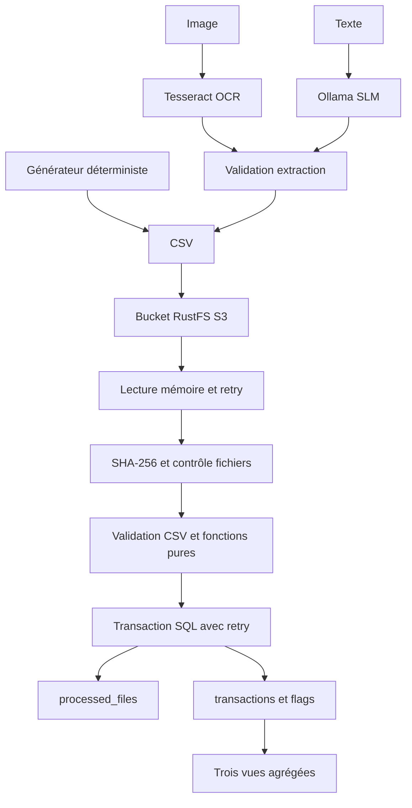

# Architecture et modèle relationnel

Le niveau 1 remplace S3 et sa lecture par `LocalSource`. L'OCR et le SLM produisent un CSV validé, puis l'étape d'upload explicite rejoint le flux commun. Le traitement n'a donc pas une logique bancaire différente selon la source.

## Tables

`processed_files` : clé primaire `content_hash`, nom de la première source traitée, nombre de lignes, horodatage d'import SQL.

`transactions` : clé composée `(content_hash, line_number)`, clé étrangère vers le fichier, sept données métier (le montant est converti en `montant_cents`), plus `flag` entier 0/1. Le numéro de ligne commence à 2 pour correspondre au CSV avec en-tête.

Trois vues : `sent_by_iban` pour `iban_origine`, `sent_by_bank` pour `banque_source`, `received_by_iban` pour `iban_destinataire`. Elles exposent `group_key` et `total_cents` sur l'ensemble des fichiers validés.

## Défaillances et concurrence

Une transaction SQL par fichier. Une exception avant commit annule le marqueur et les lignes. Le retry ouvre une nouvelle connexion. Si le commit a réussi mais que le client a perdu sa réponse, une reprise rencontrera la clé unique déjà présente et ignorera l'insertion : les lignes ne sont pas dupliquées. SQLite sérialise les écritures ; PostgreSQL arbitre la contrainte unique.

Les flags ne déclenchent pas de blocage : ils signalent un montant strictement supérieur à 5000 €, conformément au sujet. Aucun modèle de détection de fraude n'est entraîné.

## Exécution locale

Un réseau Docker local relie PostgreSQL, RustFS et l’application Python. PostgreSQL reste interne ; les ports S3 et Ollama sont liés à localhost du PC. Les volumes du projet Compose `tp-idc` persistent après un arrêt normal.

Le niveau 3 comprend uniquement l’OCR Tesseract et le SLM Ollama. Aucune infrastructure distante ni machine virtuelle à administrer n’est requise. GitHub Actions teste le code et les conteneurs sans déployer de service externe.
