# TP — Intégration et déploiement continu

**Binôme : Jason et Salma**  
**Dépôt : [jayjay932/tp-idc](https://github.com/jayjay932/tp-idc)**

Nous avons réalisé une pipeline de transactions financières, depuis la génération des données jusqu’à leur insertion en base. Nous avons traité les niveaux 1 et 2, puis choisi les options **OCR et SLM** pour le niveau 3. L’environnement fonctionne localement avec Docker, sans déploiement cloud.

## Pipeline locale et traitements

Nous avons généré trois fichiers CSV contenant chacun six transactions. Les données sont reproductibles et comprennent notamment des montants de 5 000 € et 5 000,01 € pour vérifier le seuil demandé. Chaque ligne contient la date, les IBAN, les pays, la banque source et le montant.

Nous avons séparé le chargement des fonctions de traitement. Ces dernières ne modifient pas les données d’entrée et donnent le même résultat pour les mêmes données. Les montants sont convertis en centimes entiers pour éviter les imprécisions des nombres flottants. Nous avons utilisé SQLite pour le premier lancement local, puis PostgreSQL dans Docker.

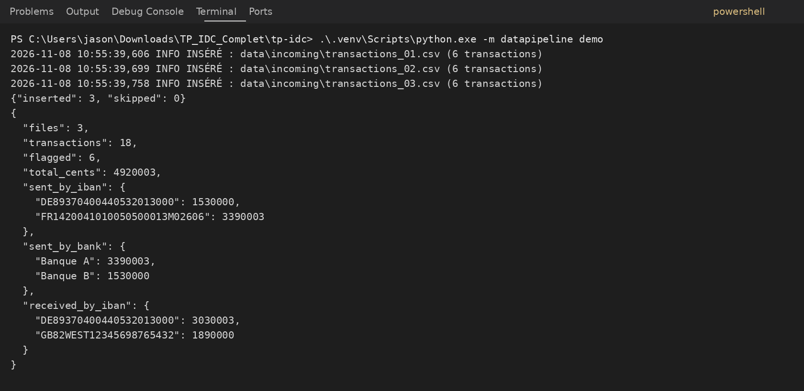

Nous obtenons **18 transactions, dont 6 supérieures à 5 000 €, pour un total de 49 200,03 €**. Le seuil est strict : une transaction de 5 000 € n’est pas signalée. Les trois regroupements donnent les résultats suivants ; les valeurs affichées dans le terminal sont en centimes.

| Traitement | Résultat obtenu en euros |
|---|---:|
| Somme envoyée par l’IBAN français | 33 900,03 |
| Somme envoyée par l’IBAN allemand | 15 300,00 |
| Somme envoyée par Banque A | 33 900,03 |
| Somme envoyée par Banque B | 15 300,00 |
| Somme reçue par l’IBAN allemand | 30 300,03 |
| Somme reçue par l’IBAN britannique | 18 900,00 |

## Tests et suivi des fichiers

Nous avons testé les calculs, les flags, la validation des données et l’insertion. Lors de l’exécution Windows présentée ci-dessous, **30 tests ont été découverts : 26 ont réussi et 4 ont été ignorés**, car ils nécessitaient des services ou variables spécifiques. Ce résultat ne signifie donc pas que les quatre intégrations avaient déjà été testées à ce moment-là ; nous avons ensuite vérifié les services avec Docker et la CI.

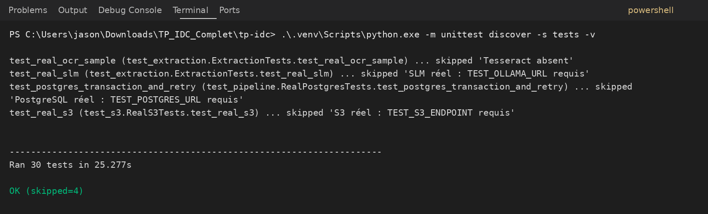

Nous avons également exécuté les scénarios d’erreur en local. Les codes retour correspondent tous à ceux attendus : le fichier invalide et l’épuisement des tentatives échouent, tandis que la correction, le rejouement et la reprise après incident réussissent.

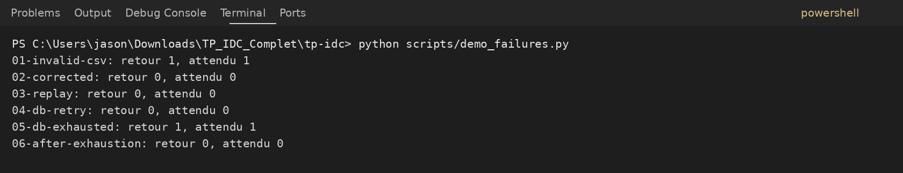

Pour éviter de traiter deux fois un fichier, nous avons enregistré son empreinte SHA-256 dans la table `processed_files`. Nous observons ici les trois contenus initiaux, avec six lignes chacun. Le marqueur et les transactions sont enregistrés dans une même transaction SQL : un échec avant le commit annule les deux. Cette protection porte sur le contenu des fichiers, y compris lorsqu’ils sont renommés.

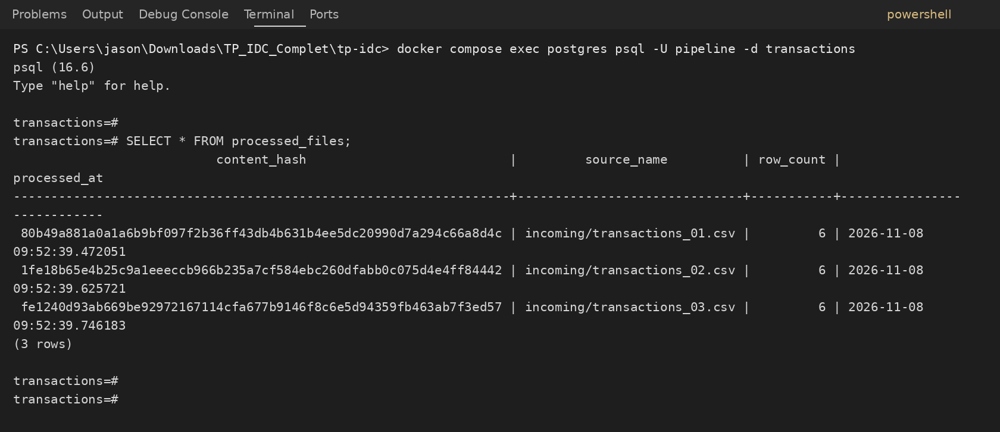

## Stockage S3 et reprise après incident

Nous avons démarré RustFS et PostgreSQL avec Docker. La pipeline prépare le bucket, génère les CSV, les envoie dans S3 et vérifie leur contenu par relecture. Le traitement récupère ensuite les objets depuis S3 avant de valider les données et de les insérer en base.

Nous avons simulé deux échecs de récupération S3 et deux échecs d’insertion PostgreSQL. Les journaux de GitHub Actions montrent des attentes de **0,20 puis 0,40 seconde**, suivies d’une réussite. Les incidents SQL sont déclenchés après les écritures mais avant leur validation définitive, ce qui permet de vérifier la reprise sans doublon.

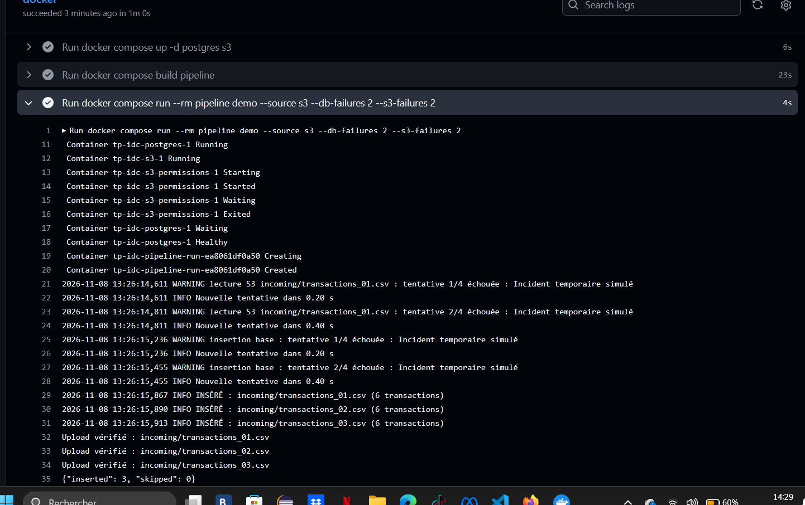

Après les reprises, nous retrouvons bien **18 transactions et 6 flags**, avec le même total initial. Les tentatives supplémentaires n’ont donc pas multiplié les lignes insérées.

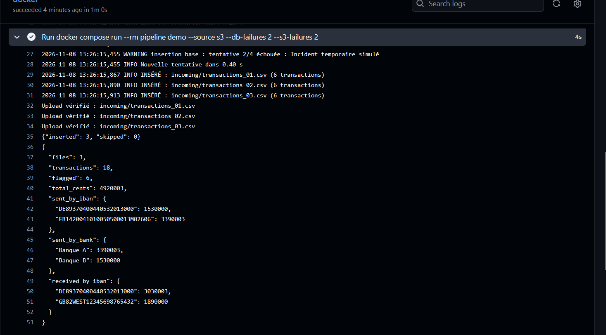

Nous avons aussi provoqué une panne dépassant les trois tentatives autorisées. Nous observons l’arrêt du traitement avec un message indiquant que le maximum est atteint. La pipeline ne continue donc pas indéfiniment lorsqu’un fichier reste inaccessible.

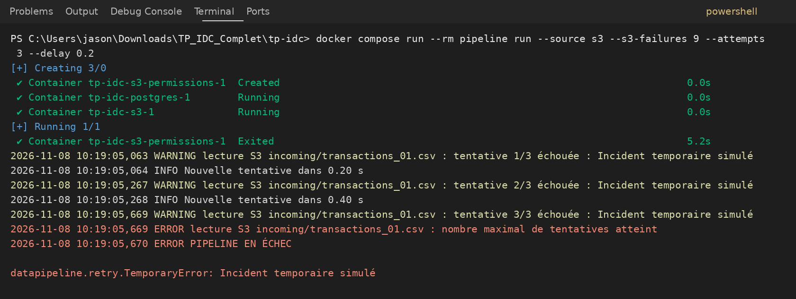

## Intégration continue et détection d’erreur

Nous avons envoyé le projet sur GitHub et automatisé les vérifications avec GitHub Actions. La CI exécute les tests Python et une stack Docker avec PostgreSQL et RustFS. Les deux exécutions présentées sont réussies, dont celle intégrant les correctifs.

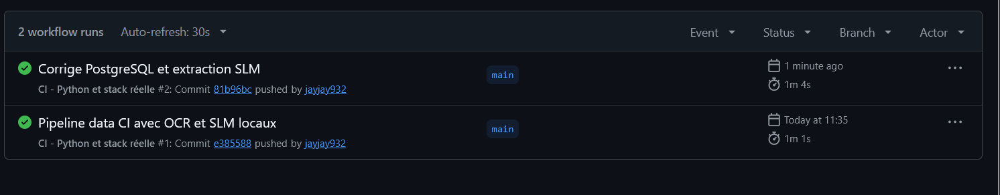

Pour montrer une erreur détectée automatiquement, nous avons lancé le scénario `invalid`. Il remplace le montant `100.00` du premier fichier par `invalide`. Le contrôle rejette alors la ligne 2, car le montant ne respecte plus le format attendu.

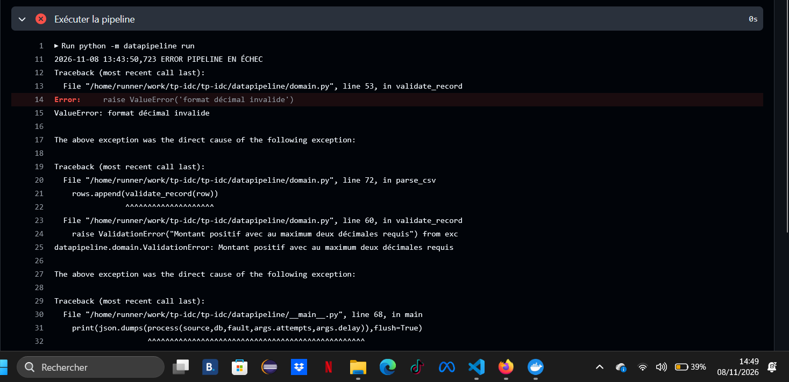

Le message précise la cause et GitHub Actions termine l’étape avec le **code de sortie 1**. Cet échec est volontaire : il montre qu’une donnée incorrecte bloque le traitement avant son insertion.

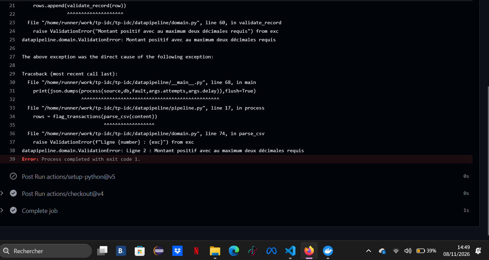

Nous avons ensuite lancé le scénario `corrected`, qui conserve les montants valides générés au départ. La pipeline réussit et retrouve les **3 fichiers, 18 transactions et 6 flags** attendus. Nous avons ainsi montré la cause du problème, sa détection et le retour à un fonctionnement correct.

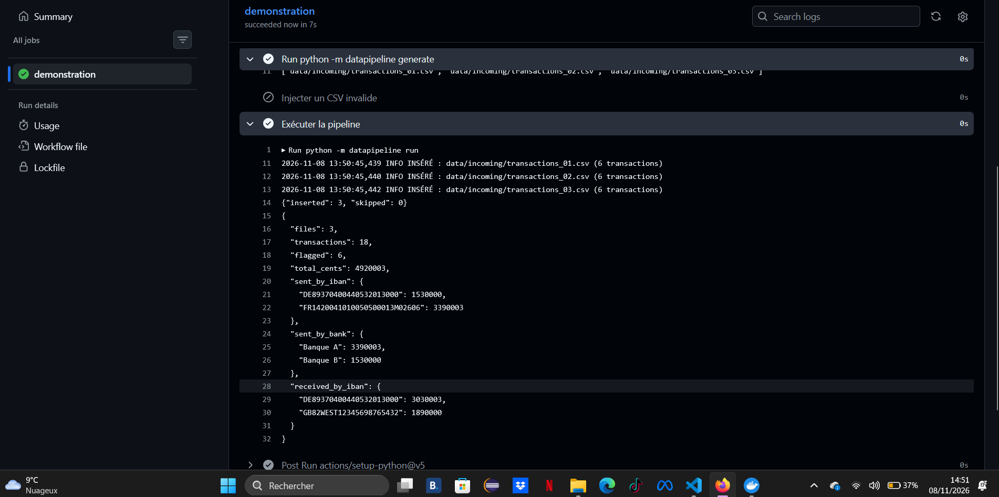

## Extraction depuis une image — OCR

Nous avons utilisé Tesseract dans Docker pour extraire une transaction depuis l’image fournie. L’exemple contient une ligne de sept champs séparés par `|`. Le texte extrait est transformé en CSV, puis soumis aux mêmes contrôles que les fichiers générés.

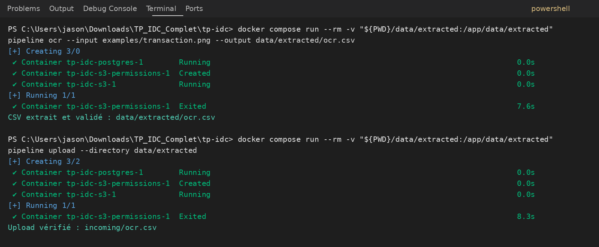

Le fichier `ocr.csv` a été récupéré depuis S3 et inséré dans PostgreSQL. Nous passons de **18 à 19 transactions**, de **6 à 7 flags**, et le total atteint **55 400,03 €**. Cela correspond à l’ajout d’une transaction de **6 200 €**, supérieure au seuil de 5 000 €.

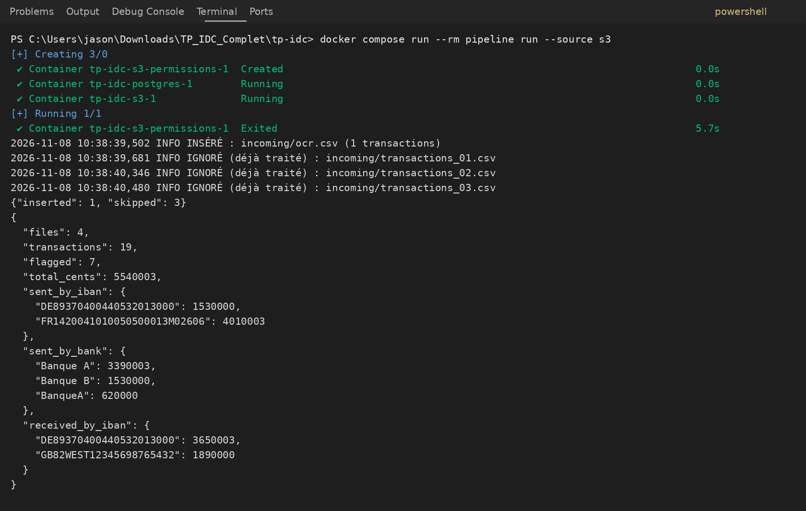

Nous remarquons que `BanqueA` et `Banque A` apparaissent séparément dans les regroupements. Les noms sont comparés tels qu’ils sont fournis ; ils ne sont pas fusionnés automatiquement.

## Extraction depuis un texte — SLM

Nous avons utilisé Ollama avec **Qwen 2.5 0.5B**, après les difficultés de téléchargement du modèle 1.5B. Le modèle extrait les sept champs dans un JSON structuré, ensuite validé et converti au format CSV commun. Nous avons précisé le format des pays et prévu la conversion de noms connus, comme « France » en `FR`, sans compléter les informations absentes.

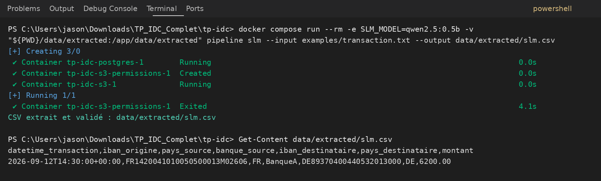

Nous observons une transaction du **12 septembre 2026 à 14 h 30 UTC**, de l’IBAN français vers l’IBAN allemand, pour **6 200 €**. Les pays `FR` et `DE`, la banque `BanqueA` et les autres valeurs correspondent au texte source. L’extraction est donc correcte sur cet exemple.

## Vérification finale de l’anti-doublons

Nous avons envoyé `ocr.csv` et `slm.csv` dans S3, puis relancé le traitement. Les deux méthodes d’extraction ont produit le même CSV : son contenu avait déjà été enregistré avec l’OCR. Nous observons **0 nouvelle insertion et 5 fichiers ignorés**.

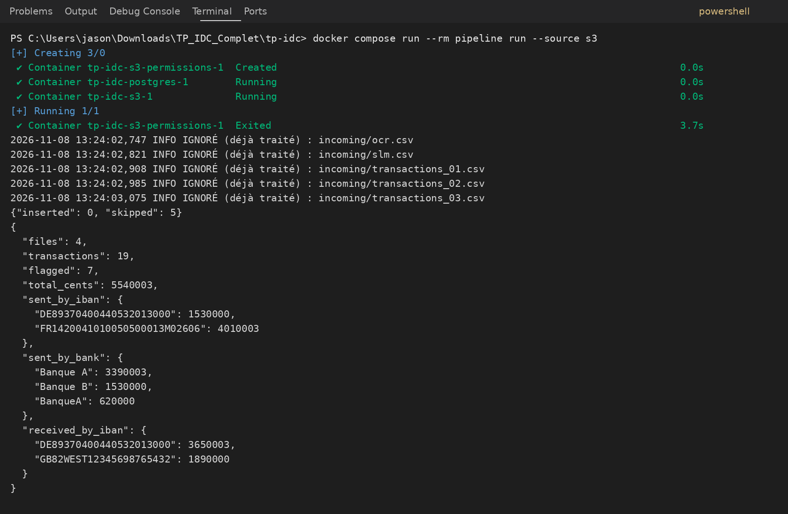

Les cinq objets S3 représentent ici quatre contenus distincts déjà traités. La base reste donc à **19 transactions, 7 flags et 55 400,03 €**. Ce résultat confirme que le mécanisme reconnaît un même contenu sous deux noms différents et que les sorties OCR et SLM rejoignent le même flux de traitement.
